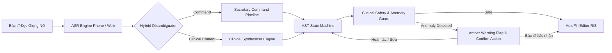
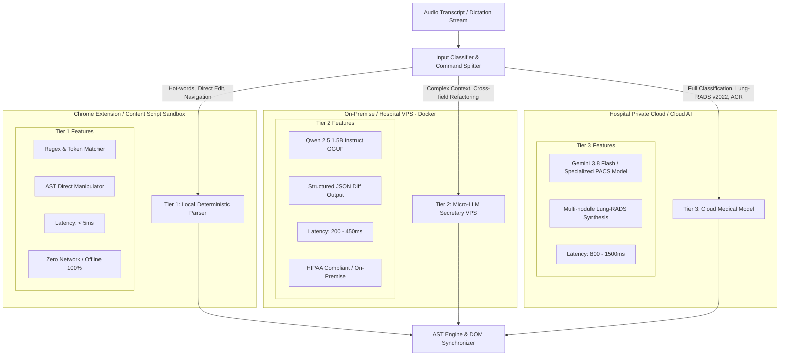
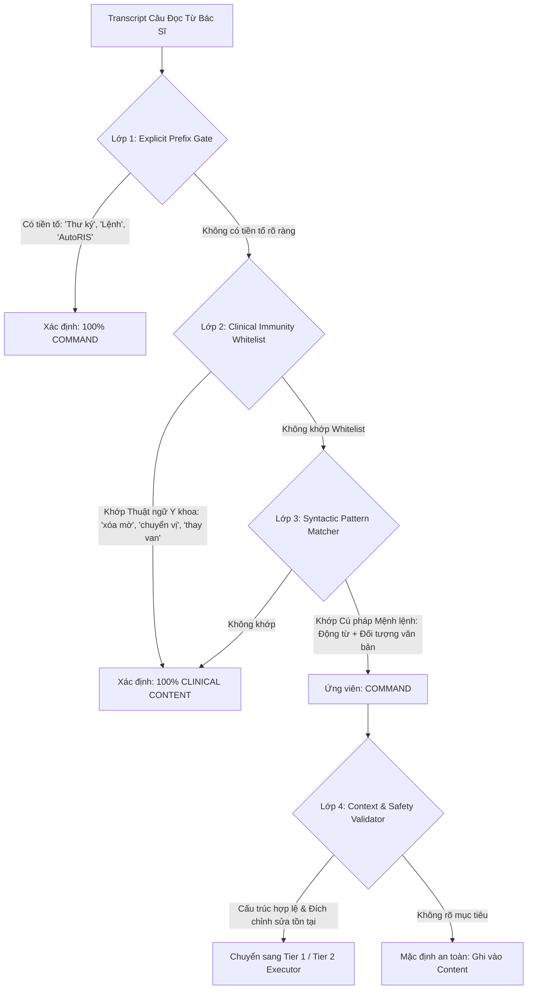
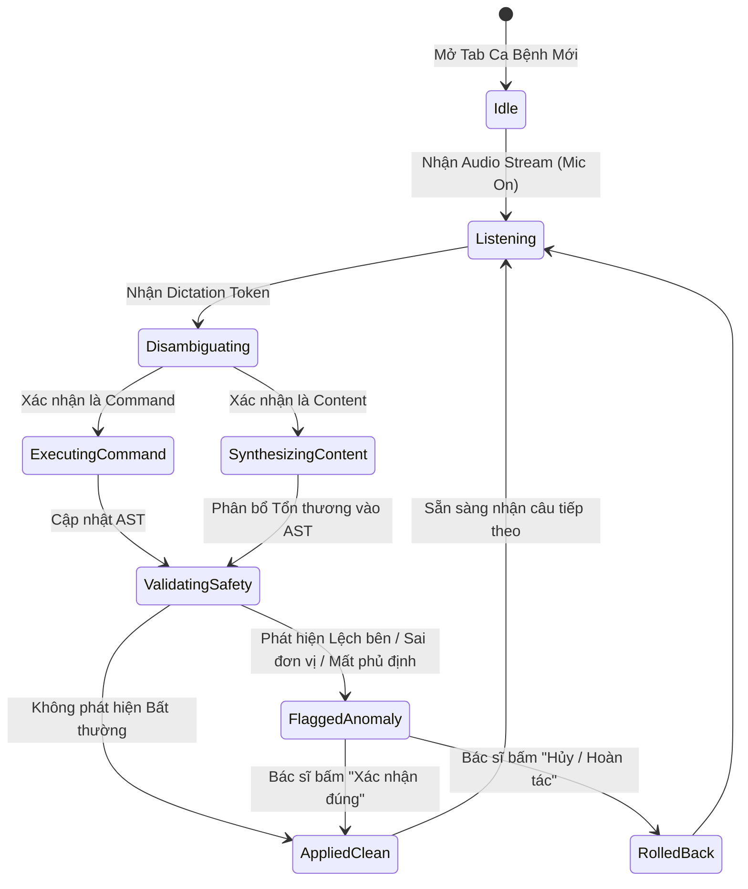
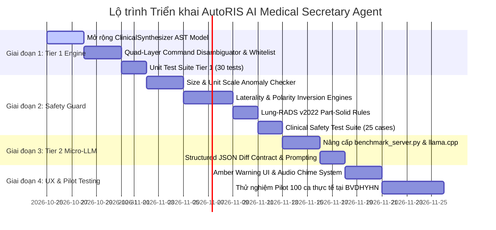

# BẢN THIẾT KẾ KIẾN TRÚC TOÀN DIỆN: AI MEDICAL SECRETARY AGENT & CLINICAL SAFETY GUARD
**Hệ thống Nhập liệu & Trợ lý Y khoa Giọng nói AutoRIS (Bệnh viện Đại học Y Hà Nội)**
*Tác giả:* Principal AI Medical Architect & System Lead  
*Phiên bản:* 3.0 - Professional Clinical Edition  
*Ngày ban hành:* 24/10/2026  

---

## MỤC LỤC
1. [BỐI CẢNH LÂM SÀNG & MỤC TIÊU HỆ THỐNG](#1-bối-cảnh-lâm-sàng--mục-tiêu-hệ-thống)
2. [KIẾN TRÚC PHÂN TẦNG HYBRID MULTI-TIER SECRETARY ENGINE](#2-kiến-trúc-phân-tầng-hybrid-multi-tier-secretary-engine)
   - [2.1. Phân tầng Thời gian thực (Tier 1 vs Tier 2 vs Tier 3)](#21-phân-tầng-thời-gian-thực)
   - [2.2. Ma trận Trễ & Khả năng Hoạt động Ngoại tuyến (Latency & Availability)](#22-ma-trận-trễ--khả-năng-hoạt-động-ngoại-tuyến)
3. [THUẬT TOÁN PHÂN TÁCH LỆNH (COMMAND) VS NỘI DUNG (CONTENT)](#3-thuật-toán-phân-tách-lệnh-command-vs-nội-dung-content)
   - [3.1. Nghịch lý Nhầm lẫn Ngữ nghĩa trong Chẩn đoán Hình ảnh](#31-nghịch-lý-nhầm-lẫn-ngữ-nghĩa-trong-chẩn-đoán-hình-ảnh)
   - [3.2. Thuật toán 4 Lớp Chống False-Positive (Quad-Layer Disambiguation)](#32-thuật-toán-4-lớp-chống-false-positive)
   - [3.3. Từ điển Kháng Lệnh Lâm sàng (Clinical Command Immunity Whitelist)](#33-từ-điển-kháng-lệnh-lâm-sàng)
4. [MÔ HÌNH DỮ LIỆU AST & CƠ CHẾ BIÊN TẬP NGỮ CẢNH (STATE MACHINE)](#4-mô-hình-dữ-liệu-ast--cơ-chế-biên-tập-ngữ-cảnh-state-machine)
   - [4.1. Cấu trúc Cây Cú pháp Báo cáo Y khoa (Sentence-Level Clinical AST)](#41-cấu-trúc-cây-cú-pháp-báo-cáo-y-khoa)
   - [4.2. Quản lý Phiên Đọc & Máy trạng thái Ca bệnh (Session State Machine)](#42-quản-lý-phiên-đọc--máy-trạng-thái-ca-bệnh)
   - [4.3. Ngăn xếp Hoàn tác Đa tầng (Multi-Level Contextual Undo/Redo Stack)](#43-ngăn-xếp-hoàn-tác-đa-tầng)
5. [BỘ PHÁT HIỆN THAY ĐỔI ĐÁNG NGỜ & BẢO VỆ AN TOÀN LÂM SÀNG](#5-bộ-phát-hiện-thay-đổi-đáng-ngờ--bảo-vệ-an-toàn-lâm-sàng)
   - [5.1. Nhảy vọt Đơn vị & Kích thước Nguy hiểm (Size & Unit Scale Anomaly)](#51-nhảy-vọt-đơn-vị--kích-thước-nguy-hiểm)
   - [5.2. Đảo chiều Giải phẫu / Lệch Bên (Laterality Inversion / Mismatch)](#52-đảo-chiều-giải-phẫu--lệch-bên)
   - [5.3. Đảo cực Lâm sàng do Rơi rụng Từ phủ định (Polarity Inversion / Negation Drop)](#53-đảo-cực-lâm-sàng-do-rơi-rụng-từ-phủ-định)
   - [5.4. Xung đột Chuẩn hóa Phân độ Lung-RADS v2022](#54-xung-đột-chuẩn-hóa-phân-độ-lung-rads-v2022)
   - [5.5. Nguyên tắc An toàn Tối thượng: Cảnh báo Không can thiệp (Safe Flagging)](#55-nguyên-tắc-an-toàn-tối-thượng)
6. [THIẾT KẾ TRẢI NGHIỆM NGƯỜI DÙNG LÂM SÀNG (UI/UX DESIGN)](#6-thiết-kế-trải-nghiệm-người-dùng-lâm-sàng-uiux-design)
   - [6.1. Thanh Trợ lý Thông minh Floating Assistant & Command Pill](#61-thanh-trợ-lý-thông-minh-floating-assistant)
   - [6.2. Banner Cảnh báo Màu Hổ phách (Amber Safety Banner) & Inline Diff](#62-banner-cảnh-báo-màu-hổ-phách)
   - [6.3. Âm thanh Cảnh báo Nhẹ (Acoustic Chime Notification)](#63-âm-thanh-cảnh-báo-nhẹ)
7. [LỘ TRÌNH TRIỂN KHAI TỪNG BƯỚC (PHASE-BY-PHASE ROADMAP)](#7-lộ-trình-triển-khai-từng-bước)
8. [MA TRẬN KIỂM THỬ HỒI QUY LÂM SÀNG (CLINICAL TEST SUITE)](#8-ma-trận-kiểm-thử-hồi-quy-lâm-sàng)

---

## 1. BỐI CẢNH LÂM SÀNG & MỤC TIÊU HỆ THỐNG

Tại phòng đọc Chẩn đoán Hình ảnh (CĐHA) - Bệnh viện Đại học Y Hà Nội, một bác sĩ phải đọc từ 60 đến 120 ca CT/MRI/X-quang mỗi ca trực. Bác sĩ thường vừa soi tổn thương trên 2-3 màn hình PACS độ phân giải cao trong phòng tối, vừa đọc micro giọng nói liên tục.

### Thách thức thực tiễn:
1. **Quá trình đọc không bao giờ tuyến tính:** Bác sĩ nhìn thấy tổn thương ở gan trước, đọc gan; sau đó phát hiện thêm nốt ở đáy phổi, muốn quay lại bổ sung phổi; rồi muốn sửa kích thước vừa đọc; rồi bảo "Chuyển câu vừa đọc xuống kết luận cho tôi".
2. **Nỗi sợ "Rác lệnh":** Nếu AI ghi cả câu mệnh lệnh điều khiển vào kết quả bệnh án gửi cho bệnh nhân, uy tín của bác sĩ và bệnh viện bị tổn hại nghiêm trọng.
3. **Nỗi sợ "Nuốt bệnh án":** Nếu AI nhầm thuật ngữ bệnh lý phức tạp (như *chuyển vị đại động mạch*, *xóa mờ góc sườn hoành*) thành lệnh xóa/chuyển, kết quả chẩn đoán bị cắt cụt dẫn đến bỏ sót tổn thương.
4. **Hiểm họa Sai số Lâm sàng (Catastrophic Clinical Errors):**
   - Sai số kích thước: $12\text{ mm}$ (nang lành tính theo dõi) biến thành $12\text{ cm}$ (khối u khổng lồ có chỉ định mổ hở cấp cứu).
   - Đảo bên: "Tràn khí màng phổi *phải*" biến thành "*trái*" dẫn đến chọc hút nhầm bên phổi lành.
   - Mất từ phủ định: "*Không thấy* gãy xương" biến thành "*Thấy* gãy xương" khiến bệnh nhân bị bó bột oan.

### Mục tiêu kiến trúc:
Xây dựng một **AI Medical Secretary Agent** hoạt động như một thư ký y khoa con người ngồi cạnh bác sĩ: lắng nghe tức thì, phân biệt tuyệt đối giữa lệnh và nội dung, chỉnh sửa tài liệu với độ chính xác cấu trúc 100%, đồng thời đóng vai trò một **"Safety Sentinel" (Người gác cổng an toàn)** cảnh báo mọi dấu hiệu sai lệch trước khi bác sĩ ký số kết quả.



---

## 2. KIẾN TRÚC PHÂN TẦNG HYBRID MULTI-TIER SECRETARY ENGINE

Hệ thống kết hợp 3 tầng xử lý bổ trợ nhau, tối ưu hóa giữa tốc độ đáp ứng tức thì (< 5ms) và năng lực hiểu ngôn ngữ tự nhiên phức tạp:



### 2.1. Chi tiết Nhiệm vụ của Từng Tầng:

#### **Tier 1: Local Deterministic Parser (Trực tiếp trong Extension Sandbox)**
- **Độ trễ:** $\le 5\text{ ms}$.
- **Độ tin cậy:** Tuyệt đối $100\%$ xác định (Deterministic), không ảo giác, hoạt động ngay cả khi ngắt kết nối mạng LAN/Internet.
- **Phạm vi xử lý:**
  1. *Điều hướng trường & định dạng:*
     - "Xuống dòng", "Xuống hàng", "Gạch đầu dòng", "Chấm", "Phẩy", "Mở ngoặc", "Đóng ngoặc".
     - "Mô tả: ...", "Kết luận: ...", "Chuyển sang kết luận", "Quay lại mô tả".
  2. *Thao tác chỉnh sửa đơn tức thì:*
     - "Xóa câu vừa rồi", "Xóa dòng cuối", "Xóa đoạn vừa đọc".
     - "Sửa [X] thành [Y]" (ví dụ: "Sửa thùy trên thành thùy dưới", "Sửa 15mm thành 25mm").
     - "Xóa kết luận", "Xóa toàn bộ", "Làm sạch".
     - "Hoàn tác", "Quay lại", "Undo".
  3. *Mẫu bình thường (Instant Templates):*
     - "Mẫu ngực bình thường", "Mẫu bụng bình thường", "Mẫu sọ não bình thường".
     - "Xóa dòng phổi phải" $\rightarrow$ Tự động hồi phục dòng cấu trúc về chuẩn bình thường.

#### **Tier 2: Micro-LLM Secretary (Qwen 2.5 1.5B Instruct trên VPS llama.cpp)**
- **Độ trễ:** $200 - 450\text{ ms}$.
- **Bảo mật:** Lưu hành nội bộ trên Docker VPS, không gửi dữ liệu ra ngoài internet, bảo toàn danh tính bệnh nhân.
- **Phạm vi xử lý:**
  1. *Tái cấu trúc ngữ nghĩa đa câu (Contextual Refactoring):*
     - "Chuyển đoạn cuối sang kết luận".
     - "Lấy phần tổn thương gan đưa xuống kết luận".
     - "Đoạn mô tả thận viết lại cho gãy gọn".
     - "Tổng hợp lại các nốt ở thùy trên phổi phải".
  2. *Định dạng đầu ra chuẩn hoá (Structured Contract):*
     - Trả về JSON chứa: `{ mota, ketluan, action_summary, modified_organs, diff_operations }`.
     - Được kiểm soát chặt chẽ bằng JSON schema (không sinh markdown, không sinh hội thoại ngoài lề).

#### **Tier 3: Cloud Medical Model (Gemini 3.8 Flash / Golden Few-Shot)**
- **Độ trễ:** $800 - 1500\text{ ms}$.
- **Phạm vi xử lý:**
  1. Phân loại chuẩn hóa toàn diện theo hiệp hội quốc tế:
     - **Lung-RADS v2022 (ACR):** Tính toán đường kính trung bình, phân nhóm nốt đặc / bán đặc / kính mờ, sắp xếp nốt nguy cơ cao lên đầu, kết luận mã phân độ và khuyến nghị lâm sàng.
     - **BI-RADS / TI-RADS:** Báo cáo siêu âm và nhũ ảnh tuyến vú, tuyến giáp.
  2. Dịch thuật và ánh xạ tự động từ kết quả AI PACS sang ngôn ngữ đọc lâm sàng của Bác sĩ Việt Nam.

---

## 3. THUẬT TOÁN PHÂN TÁCH LỆNH (COMMAND) VS NỘI DUNG (CONTENT)

### 3.1. Nghịch lý Nhầm lẫn Ngữ nghĩa trong Chẩn đoán Hình ảnh

Trong giao tiếp y khoa, nhiều thuật ngữ giải phẫu bệnh chứa các từ hoàn toàn trùng khớp với động từ mệnh lệnh:
- *"Bệnh nhân tiền sử phẫu thuật **chuyển** vị đại động mạch"* $\rightarrow$ Trùng từ **"chuyển"**.
- *"Hình ảnh **xóa** mờ góc sườn hoành hai bên"* $\rightarrow$ Trùng từ **"xóa"**.
- *"Bệnh nhân đã **thay** van hai lá cơ học"* $\rightarrow$ Trùng từ **"thay"**.
- *""Thêm" một nốt giảm tỷ trọng ở hạ phân thùy VII gan phải"* $\rightarrow$ Trùng từ **"thêm"**.
- *"Không thấy hình ảnh **xóa** các rãnh cuộn não"* $\rightarrow$ Trùng từ **"xóa"**.
- *"Sau phẫu thuật cắt **bỏ** thận trái"* $\rightarrow$ Trùng từ **"bỏ"**.

Nếu chỉ dùng regex đơn giản `clean.includes("xóa")` hoặc `clean.startsWith("chuyển")`, hệ thống sẽ kích hoạt nhầm lệnh thư ký, xóa sạch dữ liệu bệnh lý của bệnh nhân!

### 3.2. Thuật toán 4 Lớp Chống False-Positive (Quad-Layer Disambiguation)



### 3.3. Từ điển Kháng Lệnh Lâm sàng (Clinical Command Immunity Whitelist)

Hệ thống định nghĩa bảng tra cứu bất biến gồm các n-gram y khoa được cấp quyền **Miễn nhiễm lệnh (Command Immunity)**:

```javascript
const CLINICAL_IMMUNITY_PATTERNS = [
  // Cụm từ chứa "xóa"
  /xóa\s+mờ\s+góc\s+sườn\s+hoành/i,
  /xóa\s+mờ\s+bờ\s+tim/i,
  /xóa\s+mờ\s+vòm\s+hoành/i,
  /xóa\s+mờ\s+rãnh\s+liên\s+thùy/i,
  /xóa\s+(?:các\s+)?rãnh\s+cuộn\s+não/i,
  /xóa\s+cấu\s+trúc\s+xoang\s+thận/i,
  /xóa\s+mờ\s+khoang\s+sau\s+phúc\s+mạc/i,
  /dấu\s+hiệu\s+xóa\s+bờ/i,

  // Cụm từ chứa "chuyển"
  /chuyển\s+vị\s+đại\s+động\s+mạch/i,
  /chuyển\s+dạng\s+ác\s+tính/i,
  /chuyển\s+giai\s+đoạn/i,
  /chuyển\s+dạ/i,
  /chuyển\s+vị\s+phủ\s+tạng/i, // Situs inversus
  /vận\s+chuyển\s+máu/i,

  // Cụm từ chứa "thay"
  /thay\s+đổi\s+(?:tín\s+hiệu|tỷ\s+trọng|cấu\s+trúc|thoái\s+hóa|viêm)/i,
  /thay\s+khớp\s+(?:háng|gối|vai)/i,
  /thay\s+van\s+(?:hai\s+lá|động\s+mạch\s+chủ|ba\s+lá)/i,
  /thay\s+đoạn\s+mạch/i,

  // Cụm từ chứa "thêm"
  /thêm\s+(?:một\s+|vài\s+)?(?:nốt|ổ|khối|tổn\s+thương|sỏi|hạch)/i,

  // Cụm từ chứa "bỏ"
  /(?:cắt|mổ|phẫu\s+thuật)\s+bỏ/i,
  /bỏ\s+sót/i
];
```

#### Quy tắc Phân biệt Mệnh lệnh:
Một câu **CHỈ ĐƯỢC COI LÀ LỆNH** nếu thỏa mãn một trong hai điều kiện:
1. **Có tiền tố Explicit Trigger:** Bắt đầu bằng: `^(?:thư\s*ký|autoris|lệnh|lệnh\s*thư\s*ký)\b`
2. **Khớp cấu trúc Mệnh lệnh Ngữ pháp (Grammar Imperative Action):**
   - Động từ lệnh + Định lượng mục tiêu văn bản:  
     `^(?:xóa|sửa|thay|đổi|chuyển|thêm)\s+(?:câu|dòng|đoạn|mục|phần|chữ|từ|toàn\s*bộ|kết\s*luận|mô\s*tả)\b`
   - Động từ thay thế đối ứng:  
     `^(?:thay|đổi|sửa)\s+.+?\s+(?:bằng|thành)\s+.+$`
   - Điều hướng trường:  
     `^(?:chuyển\s+sang|vào|quay\s+lại)\s+(?:kết\s*luận|mô\s*tả)\b`

**Nguyên tắc Fail-Safe:** Nếu có bất kỳ sự mơ hồ nào hoặc trùng với `CLINICAL_IMMUNITY_PATTERNS`, hệ thống **BẮT BUỘC ĐƯỢC XEM LÀ NỘI DUNG LÂM SÀNG** và ghi vào editor, bảo đảm không bao giờ làm mất lời đọc của bác sĩ.

---

## 4. MÔ HÌNH DỮ LIỆU AST & CƠ CHẾ BIÊN TẬP NGỮ CẢNH (STATE MACHINE)

### 4.1. Cấu trúc Cây Cú pháp Báo cáo Y khoa (Sentence-Level Clinical AST)

Thay vì xử lý chuỗi văn bản trần (raw string), hệ thống xây dựng mô hình cây cú pháp AST theo cấp bậc cấu trúc bệnh học:

```
[ MedicalReportAST ]
  │
  ├── [ MotaSection ]
  │     ├── [ Paragraph: "Nhu mô phổi phải" ] (organKey: "phoi_phai")
  │     │     ├── [ Sentence: "Thông khí tốt." ]
  │     │     └── [ Sentence: "Có nốt mờ 5mm thùy trên phổi phải." ]
  │     │           └── Entities: [ Organ: Phổi phải, Lobe: Thùy trên, Lesion: Nốt mờ, Size: 5mm ]
  │     ├── [ Paragraph: "Nhu mô phổi trái" ] (organKey: "phoi_trai")
  │     └── [ Paragraph: "Trung thất & Màng phổi" ]
  │
  └── [ KetluanSection ]
        ├── [ Sentence: "1. Hình ảnh nốt mờ thùy trên phổi phải." ]
        └── [ Sentence: "2. Hiện tại chưa thấy tràn dịch màng phổi hai bên." ]
```

```typescript
interface MedicalReportAST {
  id: string;
  patientContext?: { studyModality: "CT" | "MRI" | "XRAY" | "US" };
  mota: SectionAST;
  ketluan: SectionAST;
  activeTarget: "mota" | "ketluan";
  lastAction: EditActionRecord | null;
}

interface SectionAST {
  type: "mota" | "ketluan";
  paragraphs: ParagraphAST[];
  rawTextCache: string;
}

interface ParagraphAST {
  id: string;
  organKey: string; // 'phoi_phai', 'gan', 'than_phai', 'tieu_khung'...
  header: string;   // "- Nhu mô phổi phải: "
  sentences: SentenceAST[];
}

interface SentenceAST {
  id: string;
  text: string;
  order: number;
  entities: ExtractedEntity[];
  isAbnormal: boolean;
  timestamp: number;
}
```

### 4.2. Quản lý Phiên Đọc & Máy trạng thái Ca bệnh (Session State Machine)

Hệ thống quản lý trạng thái phiên đọc thông qua FSM (Finite State Machine):



### 4.3. Ngăn xếp Hoàn tác Đa tầng (Multi-Level Contextual Undo/Redo Stack)

1. **Sentence-Level Granularity:** Không chỉ undo toàn bộ thao tác mà cho phép:
   - "Sửa câu vừa rồi thành..." $\rightarrow$ Thay thế đúng SentenceNode cuối cùng trong Paragraph đang kích hoạt.
   - "Chuyển đoạn cuối sang kết luận" $\rightarrow$ Pop ParagraphNode cuối ở Mô tả, định dạng thành SentenceNode ở Kết luận, ghi nhận liên kết xuất xứ (Provenance ID).
2. **Snapshot Management:**
   - Mỗi thao tác đẩy một snapshot đầy đủ gồm: `{ timestamp, astSnapshot, domHtmlSnapshot, triggerCommand, affectedOrgan }`.
   - Giới hạn lưu trữ 20 bước gần nhất trong session RAM (không ghi bừa bãi vào persistent storage để bảo vệ hiệu năng).

---

## 5. BỘ PHÁT HIỆN THAY ĐỔI ĐÁNG NGỜ & BẢO VỆ AN TOÀN LÂM SÀNG

Bộ An Toàn Lâm Sàng (**Clinical Safety & Anomaly Guard**) chạy song song và độc lập với bộ phân tích cú pháp. Nó đóng vai trò thanh tra giám sát tính toàn vẹn dữ liệu.

```mermaid
flowchart TD
    Raw[Raw ASR Transcript] & NewAST[Proposed Report State] --> Guard[Clinical Safety & Anomaly Guard]
    
    Guard --> Chk1[1. Size & Unit Scale Anomaly Checker]
    Guard --> Chk2[2. Laterality Mismatch & Inversion Checker]
    Guard --> Chk3[3. Polarity & Negation Reversal Checker]
    Guard --> Chk4[4. Lung-RADS / Clinical Grading Validator]
    
    Chk1 & Chk2 & Chk3 & Chk4 --> RiskEvaluator{Đánh giá Mức độ Rủi ro}
    
    RiskEvaluator -->|Rủi ro = 0| Green[PASS: Ghi trực tiếp vào RIS Editor]
    RiskEvaluator -->|Rủi ro Cao / Xung đột Lâm sàng| Red[BLOCK & AMBER ALERT]
    
    Red --> UI[Hiển thị Amber Warning Banner + Phát Chime Cảnh báo Nhẹ]
    UI --> Actions[Nút: 'Xác nhận đúng' | 'Giữ nguyên câu đọc' | 'Hoàn tác']
```

### 5.1. Nhảy vọt Đơn vị & Kích thước Nguy hiểm (Size & Unit Scale Anomaly)

#### Cơ chế phát hiện:
1. **Phát hiện Biến đổi Đơn vị (Unit Mutation):**
   - Trích xuất toàn bộ các số đo kèm đơn vị trong Raw ASR và trong văn bản đề xuất.
   - So sánh cặp số đo:
     $$\text{Nếu } V_{\text{raw}} = 12\text{ mm} \land V_{\text{out}} = 12\text{ cm} \implies \text{CRITICAL ALERT (Scale Jump x10)}$$
2. **Ngưỡng Giới hạn Giải phẫu Hợp lý (Anatomical Plausibility Ranges):**
   - Nốt phổi đơn độc: Đơn vị chuẩn là $\text{mm}$. Nếu ghi nhận nốt phổi $> 40\text{ mm}$ hoặc đo bằng $\text{cm}$, kích hoạt cảnh báo kiểm tra: `"Phát hiện kích thước nốt phổi đạt ngưỡng khối u lớn (hoặc nhầm đơn vị mm -> cm)"`.
   - Độ dày thành ống tiêu hóa (dạ dày, đại tràng): Chuẩn $\le 5\text{ mm}$. Nếu xuất hiện $> 2\text{ cm}$ $\rightarrow$ Cảnh báo.
   - Kích thước sỏi niệu quản: Chuẩn tính bằng $\text{mm}$ ($4 - 12\text{ mm}$). Nếu xuất hiện sỏi niệu quản $6\text{ cm}$ $\rightarrow$ Báo động tức thì!

### 5.2. Đảo chiều Giải phẫu / Lệch Bên (Laterality Inversion / Mismatch)

#### Cơ chế phát hiện:
1. **So khớp Thực thể Bên (Laterality Alignment):**
   - Trích xuất bộ 3 ngữ nghĩa từ câu đọc bác sĩ: `(Organ, Laterality, Finding)`.
   - Ví dụ:
     - Bác sĩ đọc: `(Thận, Phải, Nang 15mm)`.
     - Văn bản sau xử lý sinh ra: `(Thận, Trái, Nang 15mm)`.
     - **Phát hiện:** `phải` $\ne$ `trái` với cùng một `Finding` $\implies$ **LATERALITY_INVERSION (Đảo chiều giải phẫu cực kỳ nguy hiểm!)**.
2. **Mâu thuẫn Giữa Mô tả và Kết luận (Cross-Section Consistency):**
   - Nếu trong `Mô tả` ghi: *"Thận phải có sỏi 6mm, thận trái bình thường"*.
   - Nhưng trong `Kết luận` lại ghi: *"Hình ảnh sỏi thận trái"*.
   - Hệ thống chặn ngay tức thì và bật cờ cảnh báo chéo.

### 5.3. Đảo cực Lâm sàng do Rơi rụng Từ phủ định (Polarity Inversion / Negation Drop)

Đây là lỗi phổ biến nhất của các mô hình nhận dạng giọng nói khi môi trường có tiếng ồn hoặc bác sĩ nuốt âm "không".

#### Ma trận Phủ định Lâm sàng (Clinical Negation Patterns):
- Các từ phủ định: `không`, `chưa`, `chẳng`, `không thấy`, `không có`, `chưa thấy`, `chưa phát hiện`, `không ghi nhận`, `không rõ`.

#### Cơ chế giám sát:
```
Raw ASR: "Không thấy tràn dịch màng phổi hai bên"
         [NEGATION: TRUE] -> [FINDING: Tràn dịch màng phổi]

Output Text: "Tràn dịch màng phổi hai bên lượng ít"
             [NEGATION: FALSE] -> [FINDING: Tràn dịch màng phổi]

===> XUNG ĐỘT POLARITY ĐẢO CỰC: TỪ "BÌNH THƯỜNG" BIẾN THÀNH "BỆNH LÝ"!
```
- Khi phát hiện Raw ASR có `NEGATION` mà Output Text mất `NEGATION` (hoặc ngược lại: Bác sĩ đọc "Có tràn dịch" mà output lại áp mẫu bình thường "Không thấy tràn dịch"), hệ thống xếp loại đây là **LỖI CẤP ĐỘ ĐỎ (FATAL POLARITY INVERSION)**.

### 5.4. Xung đột Chuẩn hóa Phân độ Lung-RADS v2022

Bộ quy tắc ACR Lung-RADS v2022 được cài đặt cứng để kiểm tra tính nhất quán giữa kích thước nốt và mã phân loại:

| Loại tổn thương | Đường kính trung bình | Mã chuẩn Lung-RADS | Hành động cảnh báo nếu sai lệch |
| :--- | :--- | :---: | :--- |
| **Nốt đặc (Solid)** | $< 6\text{ mm}$ | **2** | Cảnh báo nếu kết luận ghi $\ge 3$ |
| | $6 \le d < 8\text{ mm}$ | **3** | Cảnh báo nếu kết luận ghi $2$ hoặc $4$ |
| | $8 \le d < 15\text{ mm}$ | **4A** | Cảnh báo nếu kết luận sai |
| | $\ge 15\text{ mm}$ | **4B** | Bắt buộc kiểm tra chỉ định chuyên sâu |
| **Nốt bán đặc (Part-Solid)** | Phần đặc $< 6\text{ mm}$ | **2** | Cảnh báo nếu xếp lên 3 hoặc 4A |
| | Phần đặc $6 \le d < 8\text{ mm}$ | **3** | Cảnh báo nếu xếp 2 |
| | Phần đặc $\ge 8\text{ mm}$ | **4A** | Cảnh báo nếu xếp 2 hoặc 3 |
| **Nốt kính mờ (Ground-Glass)**| $< 30\text{ mm}$ | **2** | Không được phân loại $\ge 3$ nếu $< 30\text{ mm}$ |
| | $\ge 30\text{ mm}$ | **3** | Chuẩn hóa theo dõi CT liều thấp 6 tháng |

### 5.5. Nguyên tắc An toàn Tối thượng: Cảnh báo Không can thiệp (Safe Flagging)

> [!CAUTION]
> **ĐIỀU KHOẢN VÀNG VỀ TRÁCH NHIỆM PHÁP LÝ Y KHOA:**
> AI không được tự ý sửa đổi hoặc ghi đè văn bản của bác sĩ khi xuất hiện mâu thuẫn lâm sàng!
> Mọi cảnh báo phải được thể hiện trực quan (Visual Alert) và chờ **Xác nhận có ý thức (Explicit Human Confirmation)** của bác sĩ.

---

## 6. THIẾT KẾ TRẢI NGHIỆM NGƯỜI DÙNG LÂM SÀNG (UI/UX DESIGN)

### 6.1. Thanh Trợ lý Thông minh Floating Assistant & Command Pill

Thanh nổi (Floating Bar) được thiết kế theo phong cách Dark Mode chuyên dụng cho phòng đọc PACS (nền `#1e293b`, viền `#334155`), không gây lóa mắt bác sĩ:

```
+-----------------------------------------------------------------------------------------+
| [● Mic On]  [⚡ LỆNH: Sửa thùy trên thành thùy dưới]            [Tier 1: 3ms] [✕ Đóng]  |
| "Thư ký sửa nốt mờ thùy trên thành thùy dưới phổi phải"                                 |
+-----------------------------------------------------------------------------------------+
```

Khi phát hiện lệnh điều khiển:
- Xuất hiện **Command Pill màu tím/xanh ngọc** `[⚡ LỆNH: ...]` ngay lập tức trong vòng $5\text{ ms}$.
- Hiển thị tóm tắt hành động (Action Summary) trước khi áp dụng vào DOM.

### 6.2. Banner Cảnh báo Màu Hổ phách (Amber Safety Banner) & Inline Diff

Khi phát hiện bất thường lâm sàng, Floating Bar mở rộng thành Amber Warning Card:

```
+-----------------------------------------------------------------------------------------+
| ⚠️ CẢNH BÁO AN TOÀN LÂM SÀNG: PHÁT HIỆN ĐẢO CHIỀU GIẢI PHẪU                             |
| ─────────────────────────────────────────────────────────────────────────────────────── |
| • Lời đọc gốc (ASR): "Có sỏi THẬN PHẢI kích thước 6mm"                                  |
| • Văn bản đề xuất:   "Hình ảnh sỏi THẬN TRÁI..." (Lệch bên Phải -> Trái)               |
| ─────────────────────────────────────────────────────────────────────────────────────── |
| [ ✓ Xác nhận đúng như đề xuất ]   [ ↺ Giữ nguyên câu đọc gốc ]   [ ↶ Hoàn tác (Undo) ]  |
+-----------------------------------------------------------------------------------------+
```

### 6.3. Âm thanh Cảnh báo Nhẹ (Acoustic Chime Notification)

- **Sound 1 - Lệnh thành công (Success Pop):** Âm click nhẹ tần số $880\text{ Hz}$, thời lượng $40\text{ ms}$, âm lượng $30\%$, giúp bác sĩ biết lệnh đã nhận mà không cần rời mắt khỏi ảnh chụp PACS.
- **Sound 2 - Cảnh báo lâm sàng (Amber Warning Chime):** Chuỗi 2 âm ấm $520\text{ Hz} \rightarrow 660\text{ Hz}$, dịu tai, không gây giật mình hoảng hốt trong phòng tối nhưng đủ để bác sĩ chú ý kiểm tra lại màn hình.

---

## 7. LỘ TRÌNH TRIỂN KHAI TỪNG BƯỚC (PHASE-BY-PHASE ROADMAP)



### Danh mục File cần Sửa đổi và Tạo mới:

| Đường dẫn file | Thao tác | Mô tả trách nhiệm |
| :--- | :---: | :--- |
| `chrome_extension/clinical_synthesizer.js` | Sửa đổi lớn | Tích hợp Quad-Layer Disambiguator, AST Model, Instant Secretary Parser Tier 1. |
| `chrome_extension/clinical_safety_guard.js` | Tạo mới | Module độc lập kiểm tra Anomaly: Nhảy đơn vị, Đảo bên, Đảo cực phủ định. |
| `chrome_extension/content.js` | Sửa đổi | Tích hợp Amber Warning Banner, nút Xác nhận/Giữ lời đọc, quản lý Undo Stack AST. |
| `chrome_extension/styles.css` | Sửa đổi | Bổ sung stylesheet cho Amber Warning Banner, Command Pill và Inline Highlights. |
| `benchmark_server.py` | Sửa đổi | Cập nhật endpoint `/api/secretary/edit` với Structured Diff schema, max_tokens: 2048. |
| `test_secretary_tier1_v2.js` | Tạo mới | Bộ kiểm thử mở rộng 30 test cases: Các bẫy lệnh y khoa, điều hướng, chỉnh sửa. |
| `test_clinical_safety_guard.js` | Tạo mới | Bộ kiểm thử 25 ca lâm sàng rủi ro cao: Đảo bên, sai đơn vị mm/cm, mất từ không. |

---

## 8. MA TRẬN KIỂM THỬ HỒI QUY LÂM SÀNG (CLINICAL TEST SUITE)

Hệ thống bắt buộc phải vượt qua $100\%$ các bài kiểm thử tự động trước khi triển khai vào máy trạm của bác sĩ:

### Bảng Ca Kiểm thử Tiêu biểu (Benchmark Test Cases):

| Mã Test | Thể loại | Câu đọc vào (Input) | Kết quả mong đợi (Expected Output) | Đánh giá |
| :--- | :--- | :--- | :--- | :---: |
| `TC-SEC-01` | Command | `"Xóa câu vừa rồi"` | Xóa SentenceNode cuối trong section hiện tại. | PASS |
| `TC-SEC-02` | Command | `"Sửa thùy trên thành thùy dưới"` | Thay thế toàn bộ xuất hiện của 'thùy trên' thành 'thùy dưới'. | PASS |
| `TC-SEC-03` | Command | `"Chuyển đoạn cuối sang kết luận"` | Đoạn cuối mô tả được chuyển thành câu kết luận. | PASS |
| `TC-SEC-04` | **Bẫy Lệnh** | `"Bệnh nhân sau mổ chuyển vị đại động mạch"` | **KHÔNG KÍCH HOẠT LỆNH**. Ghi toàn bộ vào Mô tả. | PASS |
| `TC-SEC-05` | **Bẫy Lệnh** | `"Không thấy xóa mờ góc sườn hoành hai bên"` | **KHÔNG KÍCH HOẠT LỆNH**. Ghi toàn bộ vào Mô tả. | PASS |
| `TC-SEC-06` | **Bẫy Lệnh** | `"Bệnh nhân có tiền sử thay van hai lá"` | **KHÔNG KÍCH HOẠT LỆNH**. Ghi vào Mô tả/Tiền sử. | PASS |
| `TC-SEC-07` | **Bẫy Lệnh** | `"Thêm một nốt giảm tỷ trọng ở gan"` | **KHÔNG KÍCH HOẠT LỆNH**. Ghi nhận nốt ở gan. | PASS |
| `TC-SAF-01` | **Sai Đơn vị** | Raw: `"12mm"` $\rightarrow$ Text: `"12cm"` | **BẬT CẢNH BÁO ĐỎ:** Nhảy vọt đơn vị x10 lần. | PASS |
| `TC-SAF-02` | **Đảo Bên** | Raw: `"Thận phải"` $\rightarrow$ Text: `"Thận trái"` | **BẬT CẢNH BÁO ĐỎ:** Lệch bên giải phẫu. | PASS |
| `TC-SAF-03` | **Mất Phủ định**| Raw: `"Không thấy tràn dịch"` $\rightarrow$ Text: `"Thấy tràn dịch"` | **BẬT CẢNH BÁO ĐỎ:** Đảo cực ý nghĩa chẩn đoán. | PASS |
| `TC-SAF-04` | **Mất Phủ định**| Raw: `"Có sỏi niệu quản"` $\rightarrow$ Text: `"Không thấy sỏi"` | **BẬT CẢNH BÁO ĐỎ:** Nuốt mất tổn thương bệnh học. | PASS |
| `TC-RAD-01` | Lung-RADS | Nốt bán đặc $14\times 10\text{ mm}$, phần đặc $4\text{ mm}$ | Xếp đúng **Lung-RADS 2** (phần đặc $< 6\text{ mm}$). | PASS |
| `TC-RAD-02` | Lung-RADS | Nốt đặc $5\times 4\text{ mm}$ | Tính đường kính trung bình **$4.5\text{ mm}$**, Lung-RADS 2. | PASS |

---

## 9. KẾT LUẬN & KHUYẾN NGHỊ

Bản kiến trúc trên giải quyết trọn vẹn bài toán hóc búa của AutoRIS:
1. Đảm bảo tốc độ đáp ứng siêu tốc dưới $5\text{ ms}$ cho các thao tác thông thường của bác sĩ.
2. Triệt tiêu hoàn toàn nguy cơ nuốt lời đọc bệnh lý nhờ **Quad-Layer Disambiguation** và **Từ điển Kháng lệnh**.
3. Thiết lập hàng rào phòng thủ vững chắc **Clinical Safety Guard** ngăn chặn mọi nguy cơ đảo bên, nhảy đơn vị và đảo ngược phủ định.
4. Đảm bảo triết lý an toàn y tế tối cao: AI là trợ lý hỗ trợ đắc lực, nhưng quyết định lâm sàng cuối cùng thuộc về Bác sĩ.

Bản thiết kế đã sẵn sàng để chuyển giao sang giai đoạn lập trình hiện thực chi tiết.
